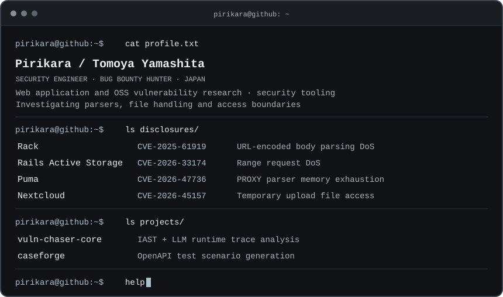

  <a href="https://pirikara.github.io/Pirikara/">
    <picture>
      <source media="(max-width: 600px)" srcset="./assets/terminal-mobile.svg" />
      
    </picture>
  </a>

  <a href="https://pirikara.github.io/Pirikara/"><strong>↳ ENTER THE INTERACTIVE TERMINAL</strong></a> 
  Try <code>help</code>, <code>whoami</code>, <code>disclosures</code>, or <code>projects</code>.

<code>ls ~/</code> &nbsp; Text index

### `cat about.txt`

I'm Tomoya Yamashita, a security engineer and bug bounty hunter based in Japan. I research vulnerabilities in web applications and open source software, build security tools, and disclose findings responsibly.

日本を拠点に、Web アプリケーションや OSS の脆弱性調査とセキュリティツールの開発に取り組んでいます。

### `ls disclosures/`

- **Rack** — [CVE-2025-61919](https://github.com/advisories/GHSA-6xw4-3v39-52mm) · URL-encoded body parsing DoS
- **Rails Active Storage** — [CVE-2026-33174](https://github.com/advisories/GHSA-r46p-8f7g-vvvg) · Range request DoS
- **Puma** — [CVE-2026-47736](https://github.com/advisories/GHSA-qpgp-93vx-g8v8) · PROXY Protocol parser DoS
- **Nextcloud** — [CVE-2026-45157](https://github.com/nextcloud/security-advisories/security/advisories/GHSA-45pj-p7x7-4mhc) · Temporary upload file access

### `ls projects/`

- **[vuln-chaser-core](https://github.com/Pirikara/vuln-chaser-core)** — an IAST and LLM proof of concept for analyzing runtime traces.
- **[caseforge](https://github.com/Pirikara/caseforge)** — generates and runs API test scenarios from OpenAPI specifications.

  <a href="https://hackerone.com/pirikara">HackerOne</a> ·
  <a href="https://qiita.com/gakinchoy7">Qiita</a> ·
  <a href="https://x.com/Piri_kara">X</a> ·
  <a href="https://stackoverflow.com/users/13829308/pirikara">Stack Overflow</a>

